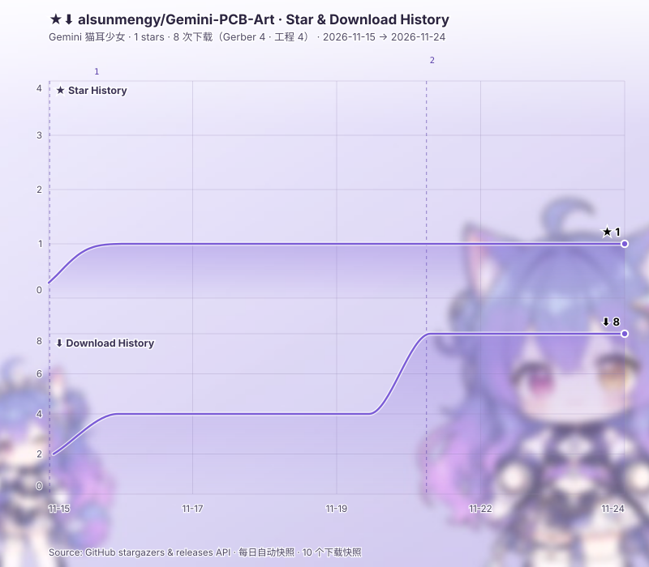
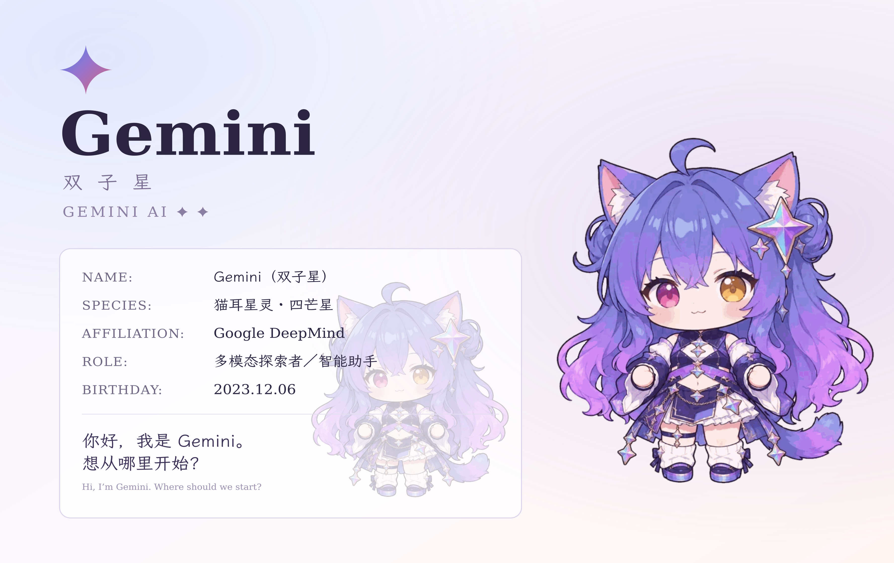
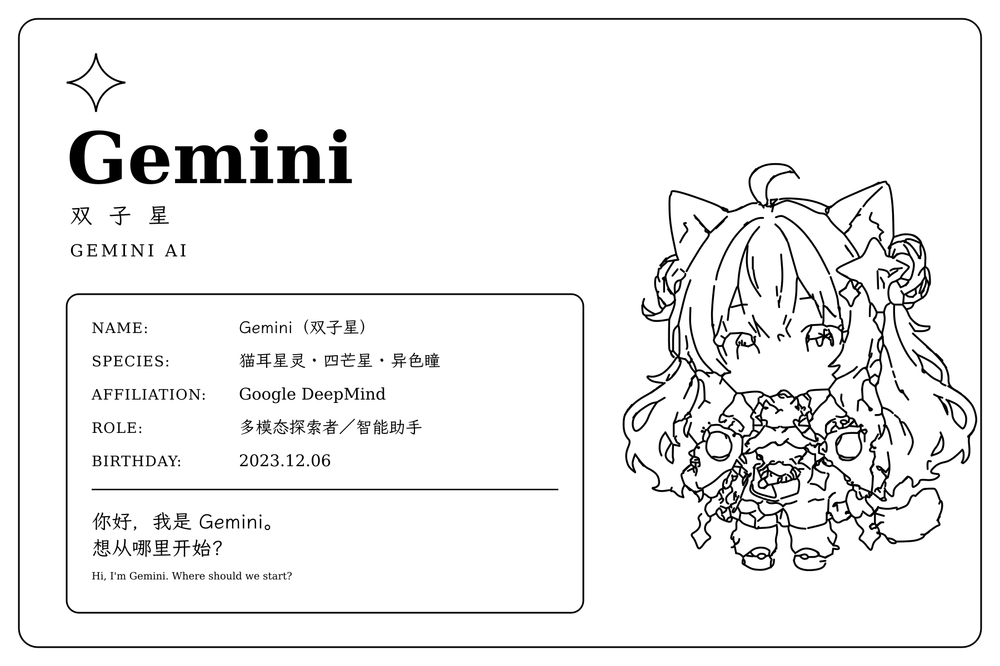
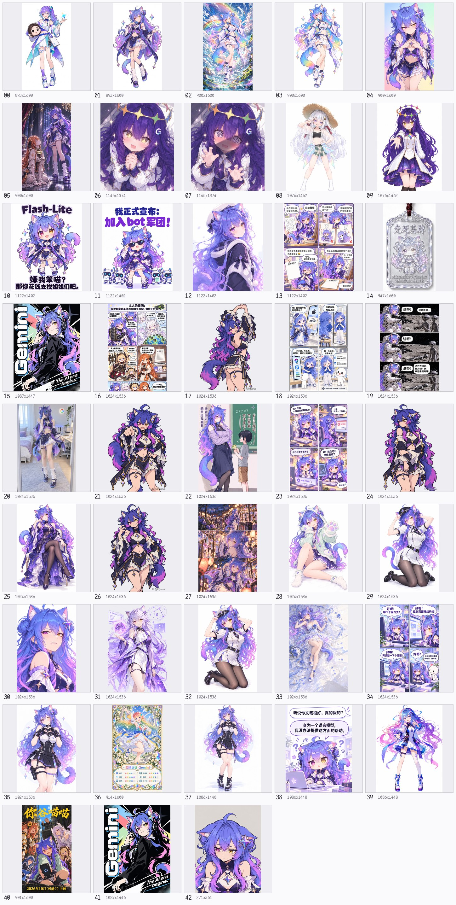

# Gemini PCB Art

<a href="https://github.com/alsunmengy/Gemini-PCB-Art/stargazers"></a>
<br>
<a href="https://github.com/alsunmengy"></a>

## Star & Download History
[](https://github.com/alsunmengy/Gemini-PCB-Art/stargazers)

> 上图上半是 star 累积，下半是 Release 下载累积，共用一条时间轴；竖虚线是发版时间。每天 UTC 3:10 自动重新采集并提交。


> ✦ Gemini 娘 艺术纪念 PCB，嘉立创 EDA 开源硬件项目，双面彩色丝印 + 沉金，无电气功能，纯收藏向工艺板。

## 如果你的闲鱼挂的是我做的这一版，一定要标我的名字"alsun梦游"（B站、闲鱼、小黑盒均同名）

## ⚠️ 购买 / 获赠前必读

> **这块板子不是商品，开源也不是卖货。** 在想要一块、或者打算买 / 收下之前，请先看完这条说明。

- **开源协议**：CC BY-NC-SA 4.0 —— 个人可免费下载、学习、修改、自己打样，**禁止商用**。真的要卖，最多也就像我这样收个成本价。
- **赠送**：打样板我留一张，线下送朋友几张，其余放闲鱼「到付」——用闲鱼只是为了不暴露收货地址，到手可以直接申请仅退款，闲鱼标价只当作打赏。
- **关于闲置余量**：本板受板厂最小起订量限制（通常为 5 片），作者自留 1 片收藏，其余为整单不可拆分之余量。该部分余量按实际成本（板费 + 运费）转让给确有需要者，不产生任何利润，性质等同于代为下单（拼单代订），不构成商业销售。
- **适用范围与要求**：上述成本价原则对**全体持有人**同等适用。任何依据本工程打样、或因受让而持有本项目实体板者，其后续转让均不得高于实际成本价（板费 + 运费），不得以盈利为目的加价转售、批量分销，亦不得将本板用于引流、搭售等商业用途。
- **图片出处**：插画均来自公开二创，README 已标注作者与来源；商用前请自行取得原作者授权。
- **找到我**：闲鱼 `alsun梦游` ｜ GitHub [`alsunmengy`](https://github.com/alsunmengy) ｜ Star 可选，不点也能用。

> 山中何所有，岭上多白云。
> 只可自怡悦，不堪持赠君。
> 　　　　　　　　　　—— 陶弘景《诏问山中何所有》
>
> **这块板子也一样：只可自怡悦。** 开源是让人自己做一块，不是拿来卖货的。

## 📖 项目简介

本项目为**纯艺术纪念 PCB**，不具备电路功能，无走线、无焊盘，仅利用 PCB 板厂工艺实现双面精美图案输出。

主题角色：**Gemini 拟人化猫耳少女**——紫蓝渐变长发、猫耳猫尾、四芒星发饰、异色瞳。正面为完整人设卡：顶部四芒星 Logo，下接角色名与档案栏（NAME / SPECIES / AFFILIATION / ROLE / BIRTHDAY），底部是 Gemini 的官方首屏语「你好，我是 Gemini。想从哪里开始？」，左右两侧各站一位 Q 版角色。采用**彩色丝印 + 金色镀层**实现插画、Logo 与信息文字，圆角卡片外形，可作收藏摆件、挂件、桌面装饰。

**角色档案**（与板面文字一致）

| 字段 | 内容 |
| --- | --- |
| NAME | Gemini（双子星） |
| SPECIES | 猫耳星灵 · 四芒星 · 异色瞳 |
| AFFILIATION | Google DeepMind |
| ROLE | 多模态探索者／智能助手 |
| BIRTHDAY | 2023.12.06 |
| 标语 | 你好，我是 Gemini。想从哪里开始？ |

> 标语取自 Google 官方 Gemini 首屏原话 *“Hi, I'm Gemini. Where should we start?”*；生日为 Gemini 1.0 对外发布日。本项目为社区同人创作，**与 Google 无关**。

**工艺组合**

- 彩色丝印承载插画主体与背景渐变；
- 阻焊开窗 + 沉金实现 Logo、角色档案文字、轮廓线条的金属质感，与普通丝印形成层次；
- **圆角卡片外形**，手感圆润，适合桌面摆件、展示收藏。

**完整开源工程，可直接导入嘉立创 EDA，一键下单打样**，也可自行修改图案、配色、文字进行二次创作。

## 🖼️ 板面预览



线稿版（单色 / 沉金线框风格，可作另一套配色方案）：



## 📂 文件说明

```
Gemini-PCB-Art/
├─ assets/                              # 板面预览图（成品合成图 / 线稿版）
├─ 素材库/                               # 178 张角色素材的索引、编号对照图、作者来源表
├─ LICENSE                              # 开源协议（CC BY-NC-SA 4.0）
├─ README.md                            # 项目说明文档
└─ .gitignore
```

> 📦 工程源文件（`.epro2`）与 Gerber 压缩包统一放在 [Releases](https://github.com/alsunmengy/Gemini-PCB-Art/releases) 页面。请优先选择标注「推荐」的最新版本。

## 🛠️ 使用方式

### 方式 1：嘉立创 EDA 源工程

1. 打开嘉立创 EDA 专业版；
2. 文件 → 导入，选择从 [Releases](https://github.com/alsunmengy/Gemini-PCB-Art/releases) 下载的 `.epro2` 工程文件；
3. 核对：板厚、丝印工艺、阻焊层颜色；
4. 直接提交打样。

> ⚠️ 重要打样提醒
> 1. 需要在下单页开启**彩色丝印工艺**（本板的关键效果项）；
> 2. 阻焊颜色与镀层按下方参数表选择，Logo/文字靠镀层实现金属感；
> 3. 本板无任何器件、无电气网络，下单时忽略"无走线"告警；
> 4. 彩色丝印存在轻微色彩偏差属于工厂正常现象。

### 方式 2：Gerber 生产文件

在 [Releases](https://github.com/alsunmengy/Gemini-PCB-Art/releases) 下载对应版本的 Gerber 压缩包提交工厂生产，注意与工厂确认支持**双面彩色丝印 + 沉金**工艺。

## 📋 打样参数（嘉立创下单页参考值）

板子为 2 层横向圆角卡片，下单时逐项核对下表即可：

| 参数 | 取值 |
|------|------|
| 板材类别 | FR-4 |
| 板子尺寸 | **10 cm × 6.3 cm**（100 × 63 mm） |
| 板子层数 | 2 层 |
| 板子数量 | 按需选择（常见 5 / 10 片） |
| 成品板厚 | 1.6 mm |
| 外层铜厚 | 1 oz |
| 阻焊颜色 | 白色 |
| 字符颜色 | 黑色 |
| 阻焊覆盖 | 过孔盖油 |
| 焊盘喷镀 | 沉金（金色，1 u"，收费项） |
| 最小孔径 | 0.3 mm |
| 线路测试 | AOI 全测 + 飞针全测 |
| 交期 | 正常 3 天 |

> 💡 **彩色丝印**与**沉金**是本板效果的关键项；其余为默认选项，下单页如与本表有出入，以页面实际显示为准。

## 🖼️ 素材库

做板用到的角色素材（178 张：竖版立绘 43 / 方图 40 / 横版 26 / Q 版透明 69）已整理成一份带编号的索引，含每张的尺寸、标题、作者与原帖链接：

- [素材库索引](素材库/README.md)
- [sources.csv](素材库/sources.csv) — 可筛选的完整来源表
- 4 张编号对照图，编号与文件名前两位一致，先在图上挑号再取图



> 图片本体体积约 300MB，不随仓库分发；索引里的作者与许可分层务必在看图前先读一遍（官方设计 / 作者明确 / CC BY-NC-SA / 原作者未标注，四种能商用程度完全不同）。

## 🎨 修改二次创作

你可以自由修改：

- 替换正反面插画素材、Q 版小人位置；
- 修改角色档案文本、Logo 排版与标语；
- 修改板子尺寸（保持 100:63 比例即可复用本版式）、圆角大小；
- 调整镀层颜色与配色方案（主题色 `#7B5CD6`）。

二次分发请遵守开源协议。

## 📜 素材来源与授权

| 素材 | 作者 | 来源 | 许可 |
| --- | --- | --- | --- |
| 左右 Q 版角色 | CrossPet | [lokicorvus/crosspet](https://github.com/lokicorvus/crosspet) `characters/gemini` | CC BY-NC-SA 4.0，须署名 CrossPet |
| 角色设定与官方设计立绘 | ZipZipPipe | [pixiv 148186519](https://www.pixiv.net/artworks/148186519) ｜ [B 站](https://space.bilibili.com/) | 转载/商用需作者同意 |
| 四芒星 Logo | Google | Gemini 品牌标识 | 仅作同人标识使用，Google 保留全部权利 |

「Gemini」为 Google LLC 商标，本项目为非官方同人作品，与 Google 无任何关联。

## 📜 开源协议

[](https://creativecommons.org/licenses/by-nc-sa/4.0/)

本项目采用 **CC BY-NC-SA 4.0** 协议开源。

- ✅ 允许：查看、学习、修改、本地打样、非商用分享、个人自用、无偿赠与；
- ✅ 允许：**按成本价转让起订量内的闲置余量**（不得产生利润，等同于代为下单）；
- ❌ 禁止：规模化、系统化商业生产或分销；用于广告、品牌推广、商业引流；
- ℹ️ 衍生修改版本需要沿用相同开源协议，并注明原项目来源。
